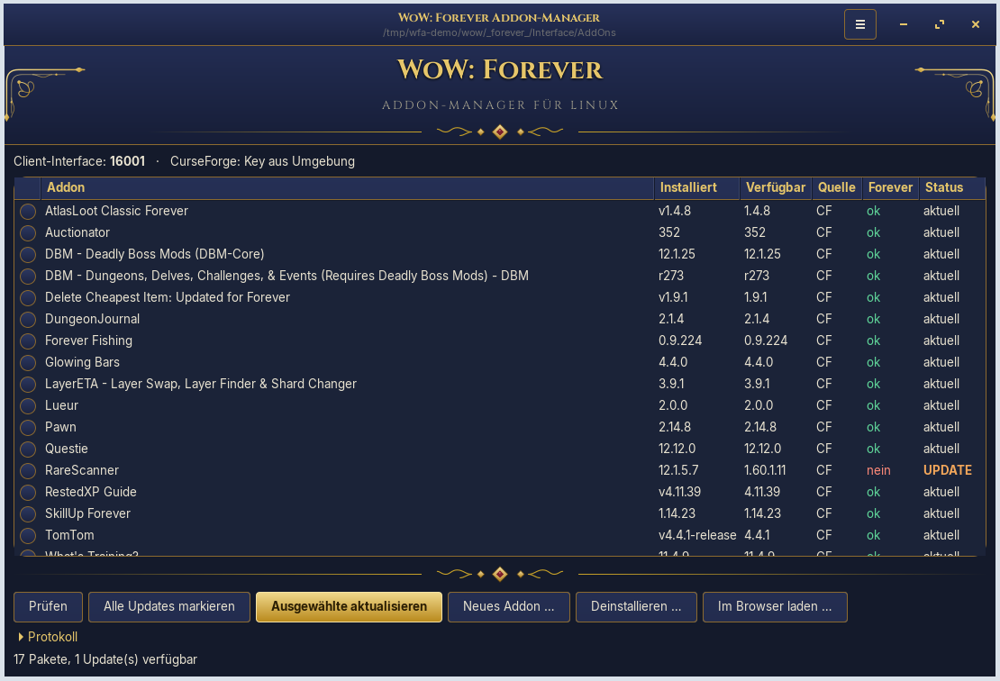

# WoW: Forever Addon-Manager (Linux)

Inoffizieller Addon-Manager für **WoW: Forever** (Interface 16xxx) unter Linux (Steam/Proton, Lutris, Wine, Bottles, Heroic). Er erkennt die Addons im `AddOns`-Ordner, zeigt Updates an und installiert sie mit Backup, auf Wunsch still im Hintergrund aus dem Tray.



## Funktionen

**Updates**
- Erkennung installierter Addons per CurseForge-Fingerprint, GitHub-Releases als Ausweichquelle; nur Forever-Builds (`.toc` mit Interface 16xxx).
- Veraltete Addons sind angehakt, „N aktualisieren“ spielt sie ein; Changelog als Tooltip.
- Updates pro Addon ignorieren, eine bestimmte Version installieren und festhalten oder auslassen.
- Addons vorübergehend deaktivieren, ohne sie zu deinstallieren: Rechtsklick → „Deaktivieren (alle Charaktere)“, zurück mit „Wieder aktivieren“. Das schaltet das Addon in der Addon-Liste aller vorhandenen Charaktere aus (AddOns.txt, vorher gesichert); die Liste zeigt „⏸ deaktiviert“. Charaktere, die danach neu angelegt werden, haben das Addon wieder an.
- Neuigkeiten zu jeder Version des Managers: ☰ → „Neuigkeiten …“.
- Kanal pro Addon (Release, Beta, Alpha), erkennbar an β/α in der Liste.
- Fehlende Pflicht-Abhängigkeiten werden angezeigt und mitinstalliert (Auto-Update: nur CurseForge).
- Nicht erkannte Ordner per Rechtsklick „Zuordnen …“ (Vorschläge aus TOC und Suche).
- Hinweise in der Statusspalte, nur wenn sonst „✓ aktuell“ stünde: „⚠ verwaist“ (CurseForge-Projekt inaktiv, aufgegeben oder gelöscht, GitHub-Repo archiviert) und „◷ lange kein Update“ (seit 180 Tagen keine neue Forever-Datei und die TOC ist älter als der Client; einstellbar unter ☰ → Einstellungen, „Hinweis „lange kein Update“ nach“, 0 = aus). Der Tooltip nennt die Gründe, die Summenzeile zählt „verwaist“. Der Projektstatus wird höchstens einmal am Tag abgefragt.
- Konflikte: Ein Ordner, der zu mehreren Addons gehört, oder ein doppelter Ordner (z. B. mit Suffix) bekommt ein „⚠“ hinter dem Namen; der Tooltip nennt die Beteiligten, die Summenzeile zählt die Konflikte. Auflösen per „Deinstallieren …“ bzw. „Zuordnen …“ oder unter ☰ → Erweitert → „Aufräumen …“.

**Updates vor dem Spielstart**
- `--update` aktualisiert veraltete Addons ohne Rückfragen (ignorierte und festgehaltene bleiben außen vor, der Kanal zählt), `--quiet` zeigt nur Zusammenfassung und Fehler, `--run CMD` startet danach das Spiel (impliziert `--update`).
- Läuft WoW schon, wird nichts geändert. Fehlt das Netz oder dauert es zu lange, startet das Spiel trotzdem. Exit-Code 0 ok, 1 Fehler, 2 übersprungen.
- Hilfe und Beispiele: ☰ → Einstellungen → „Hintergrund“ → „Updates vor dem Spielstart …“ (Befehle zum Kopieren, „Startskript speichern …“). Das Ergebnis jedes Laufs steht unter ☰ → Verlauf.
- Steam, Startoptionen: `<Programm> --update --quiet --run %command%`
- Lutris: Spiel konfigurieren → Systemoptionen → „Pre-launch script“ auf das gespeicherte Startskript setzen, „Wait for pre-launch script completion“ einschalten.
- Heroic: Spieleinstellungen → Erweitert → Skript vor dem Start: das Startskript wählen.
- Flatpak: `flatpak run io.github.m3rtl.WowForeverAddonManager --update --quiet ; %command%` (ohne `--run`, das Spiel startet Steam selbst). Lutris und Heroic nutzen ebenfalls das Startskript.
- `<Programm>` ist der Aufruf des laufenden Programms (Release-Datei, `wow-forever-addon-manager` beim AUR-Paket, `start.sh` aus dem Quellcode); der Vorstart-Dialog zeigt ihn fertig.

**Mehrere Installationen**
- Mehrere WoW-Installationen (z. B. Steam und Lutris) lassen sich verwalten. Ab zwei Einträgen erscheint in der Kopfzeile ein Umschalter (Tooltip „Installation wechseln“); der Wechsel liest nur und geht auch bei laufendem WoW.
- Verwalten unter ☰ → Einstellungen → „Installationen“: „Hinzufügen …“, „Umbenennen …“, „Entfernen“ (nur der Eintrag, keine Dateien), „Aktivieren“.
- Backups, SavedVariables-Sätze, Gesamtstände und Papierkorb gehören zur jeweiligen Installation; Backups, Gesamtstände und Papierkorb nennen sie über der Liste.

**Downloads**
- Wege: CurseForge-API, Website-Link, CDN (auch für gesperrte Addons wie DBM), mit Fortschritt und Wiederholung.
- Zuletzt der Browser: Der Manager wartet im Download-Ordner auf die Zip-Datei.

**Neue Addons**
- Alle Forever-Addons durchblättern, sortieren, filtern.
- Außerdem: CurseForge-Projekt-ID, `gh:owner/repo`, GitHub-URL, Zip-Link oder lokale Zip-Datei („Direkt“).
- Addon-Liste exportieren/importieren (☰): JSON oder Kurztext `WFA1 cf:18808 cf:4646@beta gh:owner/repo`.


**Sicherheit**
- Ersetzte oder deinstallierte Ordner landen im Backup (letzte 5), wiederherstellbar über ☰ → Backups.
- Gesamtstände (☰ → „Gesamtstände …“): alle Addons und `WTF/Account` als ein Satz sichern (letzte 3) und mit einem Klick wiederherstellen, z. B. vor einem großen Patch. Dazu entstehen automatisch Stände, die du nicht anlegen musst: vor einem Update ab 5 Addons und bei neuer WoW-Version (beides unter ☰ → Einstellungen → „Sicherungen“ einstellbar, Standard an). Es bleiben die letzten 2 automatischen Stände, eigene werden nie verdrängt; die Spalte „Art“ unterscheidet „manuell“ und „automatisch“.
- SavedVariables-Schnappschuss vor jedem Update (letzte 5, abschaltbar), Wiederherstellen nur bei beendetem WoW.
- ☰ → „Verlauf …“: „Zurücksetzen“ und „Einstellungen zurücksetzen“ je Addon.
- Kompatibilitätsprüfung vor jeder Installation, Hinweis wenn WoW zu laufen scheint.
- Beim Ersetzen von Addon-Ordnern bleibt `WTF` unverändert; geschrieben wird dort nur beim ausdrücklichen Wiederherstellen.

**Erweitert** (☰ → Einstellungen → „Allgemein“ → „Erweiterte Funktionen anzeigen“, Standard aus; dann ☰ → Erweitert mit „Addons je Charakter und Sets …“, „Aufräumen …“ und „Fehleranalyse …“)
- Addons je Charakter oder für alle Charaktere an- und ausschalten, ohne sie zu deinstallieren.
- Aufräumen: Speicherbelegung, Einstellungen deinstallierter Addons, verschachtelte Ordner, Ordner ohne TOC. Alles landet erst im Papierkorb (letzte 5) und lässt sich zurücklegen.
- Addon-Sets (im Dialog „Addons je Charakter und Sets …“): die aktuell angehakten Addons als Set speichern („Speichern als …“, „Umbenennen …“, „Löschen“) und auf einen oder alle Charaktere anwenden, z. B. ein Set „Raid“ und eines „Leveln“. Die Auswahl zeigt zuerst nur eine Vorschau; Abhängigkeiten werden mit eingeschaltet, nicht installierte Addons des Sets gemeldet. Vor dem Schreiben wird `AddOns.txt` gesichert.
- Fehleranalyse (☰ → Erweitert → „Fehleranalyse …“): wertet aus, was das Addon !BugGrabber aufzeichnet, gruppiert nach Addon und zeigt, welche Fehler erst seit dem letzten Update aufgetreten sind. „Zurücksetzen …“ stellt dessen Backup her. Ohne !BugGrabber bietet der Dialog die Suche an. Die Daten schreibt WoW beim Abmelden oder mit `/reload`.
- Geschrieben wird nur bei beendetem WoW.

**Sprache**: Deutsch oder Englisch nach Systemsprache, fest einstellbar unter ☰ → Einstellungen (wirkt nach Neustart) oder per `WFA_LANG=de|en`.

## Installation

**Release-Datei** (eine ausführbare Datei, aktualisiert sich selbst)

1. [Neuestes Release](https://github.com/m3rtl/wow-forever-addon-manager-linux/releases/latest): `wow-forever-addon-manager-x86_64-linux` laden (Prüfsumme: `SHA256SUMS`).
2. `chmod +x wow-forever-addon-manager-x86_64-linux`
3. `./wow-forever-addon-manager-x86_64-linux` (gebaut auf Ubuntu 22.04, braucht glibc 2.35+; bei älteren Systemen AUR, Flatpak oder Quellcode nutzen)

**Arch Linux (AUR)**: Paket `wow-forever-addon-manager`, z. B. `yay -S wow-forever-addon-manager`. Nutzt das Python und GTK des Systems, daher keine glibc-Vorgabe. Updates kommen über die Paketverwaltung.

**Flatpak**: `wow-forever-addon-manager-x86_64.flatpak` aus dem Release laden und `flatpak install --user wow-forever-addon-manager-x86_64.flatpak`. Läuft auf jeder Distribution mit Flatpak; die GNOME-Runtime kommt von Flathub. Updates: neues Bundle installieren. Hinweise zur Sandbox siehe [Flatpak](#flatpak).

## Bedienung

| Was | Wo |
| --- | --- |
| Auf Updates prüfen | Refresh-Symbol oben links, <kbd>F5</kbd>, <kbd>Strg</kbd>+<kbd>R</kbd> |
| Markierte aktualisieren | „N aktualisieren“ unten links |
| Changelog, Ignorieren, Deaktivieren, Seite/Ordner öffnen, Browser-Download, Deinstallieren | Rechtsklick auf eine Zeile (oder Menütaste) |
| Andere Version, Festhalten/Auslassen aufheben, Kanal, Zuordnen, Verlauf | Rechtsklick auf eine Zeile |
| Installation wechseln (ab zwei Installationen) | Umschalter in der Kopfzeile neben dem Refresh-Symbol |
| Protokoll, Backups, Gesamtstände, Verlauf, Addon-Liste exportieren/importieren, Einstellungen, Programm-Updates, Beenden | ☰-Menü oben rechts |

Kommandozeile: `./start.sh --cli` (Menütasten u. a. `v` Version/Kanal, `h` Verlauf, `w` Backups inkl. SavedVariables), `--export PFAD|-` und `--import PFAD|TEXT`, Gesamtstände mit `--snapshot [BEZEICHNUNG]`, `--snapshots` und `--restore-snapshot ID`, Aufräumen mit `--cleanup` (nur anzeigen) und `--cleanup --apply`.

| Flag | Wirkung |
| --- | --- |
| `--update`, `--quiet`, `--run CMD …` | Updates ohne Rückfragen, nur Zusammenfassung/Fehler, danach Spiel starten (Exit-Code 0 ok, 1 Fehler, 2 übersprungen) |
| `--sets`, `--set NAME`, `--char NAME-REALM` | Addon-Sets auflisten, auf alle oder nur diese Charaktere anwenden (`--char` mehrfach erlaubt) |
| `--errors [ADDON]` | Fehleranalyse aus !BugGrabber, mit ADDON samt Beispielen (Exit-Code 0 Analyse lief, auch ohne Treffer; 1 nicht möglich) |
| `--installations`, `--use NAME\|PFAD` | Installationen auflisten, dauerhaft wechseln |
| `--addons-dir PFAD` | AddOns-Ordner nur für diesen Lauf |

Im interaktiven Menü wechselt die Taste `i` die Installation (nur bei zwei oder mehr).

## Tray und Autostart

Unter ☰ → Einstellungen, „Hintergrund“: Start im Tray beim Systemstart, Prüfintervall, Auto-Update (nur wenn WoW nicht läuft; Standard aus). Der Tray folgt der aktiven Installation. Unter GNOME braucht der Tray die Erweiterung „AppIndicator and KStatusNotifierItem Support“.

## Programm-Updates

Prüfung über GitHub-Releases (höchstens alle 12 h). Die Release-Datei ersetzt sich nach SHA256-Prüfung selbst (alte als `.old`), die Quellcode-Version zeigt nur einen Hinweis. Abschaltbar unter ☰ → Einstellungen. AUR-Paket und Flatpak prüfen nicht selbst; dort aktualisiert die Paketverwaltung.

## Flatpak

WoW: Forever liegt in einem Wine/Proton-Prefix, also außerhalb der Sandbox. Das Flatpak bekommt deshalb nur Zugriff auf die üblichen Orte:

| Freigabe | Wofür |
| --- | --- |
| `~/.steam`, `~/.local/share/Steam`, `~/.var/app/com.valvesoftware.Steam/.local/share/Steam` | Steam/Proton (auch Steam als Flatpak) |
| `~/Games`, `~/.wine`, `~/.local/share/lutris`, `~/.local/share/bottles`, `~/.var/app/com.usebottles.bottles/data/bottles`, `~/.local/share/umu`, `~/Faugus` | Heroic, Lutris, Wine, Bottles, umu, Faugus |
| Download-Ordner (nur lesen) | Browser-Download als letzter Ausweg |
| `~/.config/wow-forever-addon-manager`, `~/.local/share/wow-forever-addon-manager` | Einstellungen, Backups und Verlauf, gemeinsam mit Release-Datei und AUR-Paket |

Liegt WoW woanders (z. B. Steam-Bibliothek auf einer zweiten Platte), gibt es zwei Wege:

- Im Programm unter ☰ → Einstellungen → „Installationen“ → „Hinzufügen …“ → „Anderen Ordner wählen …“ den Ordner **„World of Warcraft“** wählen. Das Datei-Portal gibt ihn dauerhaft frei. Nicht nur `AddOns` wählen: Client-Version (`.build.info`) und SavedVariables (`WTF`) liegen darüber.
- Oder den Ordner fest freigeben, z. B. `flatpak override --user --filesystem=/mnt/Spiele/SteamLibrary io.github.m3rtl.WowForeverAddonManager`. Steam-Bibliotheken, die in `libraryfolders.vdf` stehen, aber nicht freigegeben sind, nennt der Auswahldialog samt passendem Befehl.

Weitere Unterschiede:

- **Läuft WoW?** Aus der Sandbox sind keine fremden Prozesse sichtbar. Ohne Freigabe meldet der Tray Updates nur und installiert sie nicht still; vor dem Wiederherstellen von SavedVariables fragt das Programm nach. Erkennung freigeben (erlaubt dem Programm, Befehle außerhalb der Sandbox zu starten): `flatpak override --user --talk-name=org.freedesktop.Flatpak io.github.m3rtl.WowForeverAddonManager`.
- **Updates vor dem Spielstart**: im Steam-Startoption-Befehl `--update --quiet ; %command%` statt `--run` (siehe oben).
- **Autostart** läuft über das Hintergrund-Portal; GNOME fragt beim ersten Einschalten nach.
- **Daten**: Einstellungen, Backups und Verlauf liegen wie bei Release-Datei und AUR-Paket in `~/.config/wow-forever-addon-manager` und `~/.local/share/wow-forever-addon-manager`; ein Wechsel zwischen den Installationsarten übernimmt also alles. Nur der Cache liegt unter `~/.var/app/io.github.m3rtl.WowForeverAddonManager/`.

Selbst bauen: `flatpak-builder --user --install --force-clean build-flatpak packaging/flatpak/io.github.m3rtl.WowForeverAddonManager.yml` (braucht `org.gnome.Sdk//51`).

## Aus dem Quellcode starten

Python 3.10+, für die GUI `python3-gi` und `gir1.2-gtk-3.0`.

```sh
./start.sh                 # GUI (ohne Display automatisch Kommandozeile)
./start.sh --tray          # minimiert im Tray
./start.sh --check         # nur die Tabelle ausgeben
./build.sh                 # Einzeldatei bauen (dist/)
python3 -m unittest discover -s tests   # Tests (offline, ohne GUI)
```

Übersetzungen liegen in `assets/locale/<sprache>.po`; die deutschen Texte im Code sind die Schlüssel. `tests/test_i18n.py` meldet fehlende Einträge.

## CurseForge-API-Key

Kostenlos unter <https://console.curseforge.com>; eintragen unter ☰ → Einstellungen oder per `CF_API_KEY` (hat Vorrang). Ohne Key gehen nur GitHub und manuell zugeordnete Pakete.

## Wo Daten gespeichert werden

- Aus dem Quellcode gestartet: neben dem Programm (`config.json`, `backups/`, `sv_backups/`, `snapshots/`, `trash/`, `addons_txt_backups/`, `history.jsonl`, `cache/`).
- Release-Datei und AUR-Paket: in den XDG-Ordnern (`~/.config`, `~/.local/share`, `~/.cache`, jeweils unter `wow-forever-addon-manager`).
- Flatpak: dieselben Ordner wie die Release-Datei; nur der Cache liegt unter `~/.var/app/io.github.m3rtl.WowForeverAddonManager/`.
- `WOW_FA_HOME=<Ordner>` überschreibt beides.
- Backups, SavedVariables-Sätze, Gesamtstände und Papierkorb merken sich ihre Installation (Kennung `.wfa-install` bzw. Feld im Satz). Sätze aus älteren Versionen gehören zur bisherigen Installation. Addon-Sets und die Liste der Installationen stehen in `config.json`.

## Datenschutz

Dein API-Key liegt nur lokal in `config.json` (Rechte 0600). Das Programm spricht nur mit CurseForge, GitHub und den Servern der Pakete, die du installierst; keine Telemetrie. Aus Browser-Profilen liest es nur den eingestellten Download-Ordner. Direkt-Download und Selbst-Update lassen sich unter ☰ → Einstellungen abschalten.

## Kompatibilitätsregeln

Das Client-Interface kommt aus `.build.info` (1.60.1 → 16001), sonst gilt die häufigste Nummer der Addons. Je Ordner zählt die erste TOC aus `<Name>_Forever.toc`, `<Name>-Forever.toc`, `<Name>.toc`. Nur kompatible oder bereits installierte Ordner werden installiert.

## Schrift und Grafiken

Titelschrift: [Cinzel](https://github.com/NDISCOVER/Cinzel), SIL Open Font License 1.1 (`assets/fonts/cinzel/OFL.txt`). Die Ornamente sind eigene Zeichnungen; es werden keine Logos, Grafiken oder Schriften von Blizzard verwendet. Das klassische Theme lässt sich unter ☰ → Einstellungen abschalten.

## Haftungsausschluss

Inoffizielles Community-Werkzeug. Nicht verbunden mit oder unterstützt von Blizzard Entertainment oder CurseForge/Overwolf. Alle Marken gehören ihren jeweiligen Inhabern. Nutzung auf eigene Gefahr; es werden Backups angelegt, eigene Sicherungen schaden trotzdem nicht.

## Lizenz

[MIT](LICENSE), Copyright (c) 2026 m3rtl.
