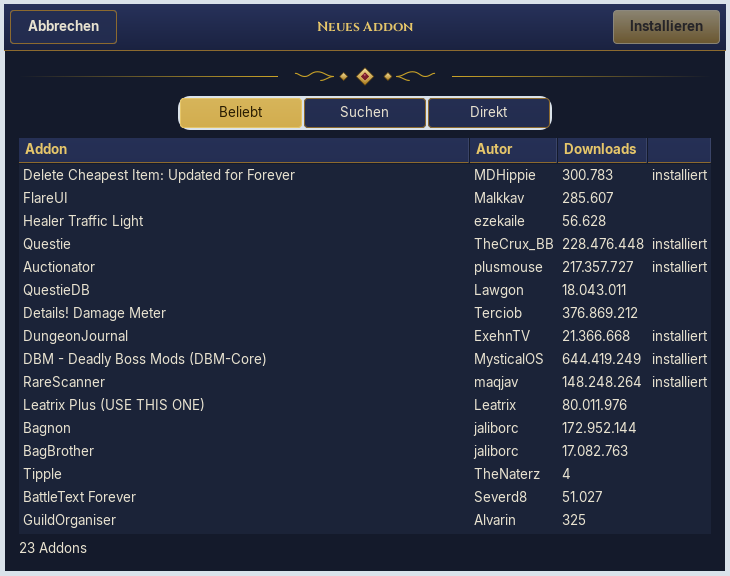

# WoW: Forever Addon-Manager (Linux)

An unofficial addon manager for **WoW: Forever** (Interface 16xxx) on Linux. It works with installations running under Steam/Proton, Lutris, Wine, Bottles or Heroic. It scans your `AddOns` folder, recognises your addons, shows available updates and installs them with an automatic backup.


## Features

- **CurseForge detection by fingerprint**: installed addons are identified by file hash, no manual setup needed.
- **Forever-only files**: picks the `_Forever` build of a release and checks the `.toc` for Interface 16xxx.
- **GitHub fallback** for addons that are published as GitHub releases.
- **Browser fallback**: if a download is not available through the API, the exact file page (or a file list prefiltered to the Forever game version) opens and the manager waits for the new zip. With several marked addons the browser downloads are processed one after another (skip or cancel anytime), followed by a summary.
- **Download folder detected from your browser**: the manager reads the download setting of your default browser (Chrome/Chromium family, Firefox family incl. Flatpak/Snap), and also watches the other detected browsers and the XDG download folder. A manual folder can be set under ☰ → Einstellungen. Only the download keys are read, nothing else from the profiles.
- **Classic look**: dark fantasy theme with gold accents and hand-drawn ornaments, switchable under ☰ → Einstellungen ("Klassisches Theme"; off = system theme).
- **Install new addons**: popular list, search, CurseForge project ID, `gh:owner/repo`, GitHub URL, direct zip link or a local zip.
- **Backups and restore**: replaced folders are moved to a backup set first (last 5 are kept). `WTF`/SavedVariables are never touched.
- **Uninstall**: removes an addon package by moving its folders to a backup set (restorable via Backups); dependencies on other addons are reported first. Settings (`WTF`/SavedVariables) stay.
- **Compatibility check** before every installation, with a warning for packages that WoW: Forever will not load. A warning is shown if WoW seems to be running (detected heuristically, so it may miss it).



## Download (easiest way)

1. Get `wow-forever-addon-manager-x86_64-linux` from the [latest release](https://github.com/m3rtl/wow-forever-addon-manager-linux/releases/latest) (verify it with `SHA256SUMS`).
2. Make it executable and start it:
   ```sh
   chmod +x wow-forever-addon-manager-x86_64-linux
   ./wow-forever-addon-manager-x86_64-linux
   ```
3. Optional: menu ☰ → "Startmenü-Eintrag anlegen" adds a launcher to your application menu (or run it with `--install-desktop-entry`).

The binary is built on Ubuntu 22.04 (glibc 2.35 or newer required) and bundles Python and GTK. It may not run on other or older distributions; in that case use the source version (`python3-gi` and GTK 3 for the GUI, otherwise the command line mode works without them).

## Run from source

Requirements: Python 3.10 or newer. For the GUI additionally `python3-gi` and GTK 3 (`gir1.2-gtk-3.0`). The command line mode needs nothing but the standard library.

```sh
./start.sh                 # GUI (falls back to the command line without a display / PyGObject)
./start.sh --cli           # interactive command line
./start.sh --check         # print the table only
./start.sh --check --addons-dir PATH
```

To build the single-file binary yourself: `./build.sh` (result in `dist/`).

## CurseForge API key

Free at <https://console.curseforge.com>. Enter it under ☰ → Einstellungen, or set the environment variable `CF_API_KEY` (takes precedence). Without a key only GitHub-based and manually assigned packages can be checked.
Some keys are not allowed to use the search endpoint; in that case use the "Popular" list, a project ID or the browser search.

## Where data is stored

- Run from source: next to the program (`config.json`, `backups/`, `cache/`).
- Release binary: XDG folders (`~/.config`, `~/.local/share`, `~/.cache` below `wow-forever-addon-manager`).
- `WOW_FA_HOME=<folder>` overrides both.

## Privacy

Your API key is stored only locally in `config.json` (permissions 0600) and is never part of this repository. The program talks only to the CurseForge API, GitHub and the download hosts of the packages you install. No telemetry.

## Compatibility rules

The client interface is read from your installation (currently 16001). For every addon folder the first existing TOC of `<Name>_Forever.toc`, `<Name>-Forever.toc`, `<Name>.toc` counts. Only compatible folders (or folders that are already installed) are installed; the rest is skipped and listed.

## Fonts and artwork

The title font is [Cinzel](https://github.com/NDISCOVER/Cinzel), licensed under the SIL Open Font License 1.1 (`assets/fonts/cinzel/OFL.txt`). It is registered at runtime only for this program; without it a fallback serif font is used. All ornaments are original drawings; no Blizzard logos, graphics or fonts are used.

## Disclaimer

Unofficial community tool. Not affiliated with or endorsed by Blizzard Entertainment or CurseForge/Overwolf. All trademarks belong to their owners. Use at your own risk; backups are made, but keep your own as well.

## License

[MIT](LICENSE), Copyright (c) 2026 m3rtl.

## Zusammenfassung (Deutsch)

Inoffizieller Addon-Manager für WoW: Forever unter Linux (Steam/Proton, Lutris, Wine, Bottles, Heroic). Erkennt installierte Addons per Fingerprint bei CurseForge, lädt die Forever-Version, installiert mit automatischem Backup und kann Addons deinstallieren (Ordner landen im Backup) und Backups wiederherstellen. Einfachster Weg: Datei aus den GitHub-Releases laden, `chmod +x`, starten. Aus dem Quellcode: `./start.sh` (GUI braucht `python3-gi` + GTK 3). Ein kostenloser CurseForge-API-Key (console.curseforge.com) wird unter ☰ → Einstellungen eingetragen und nur lokal gespeichert. Lizenz: MIT.
